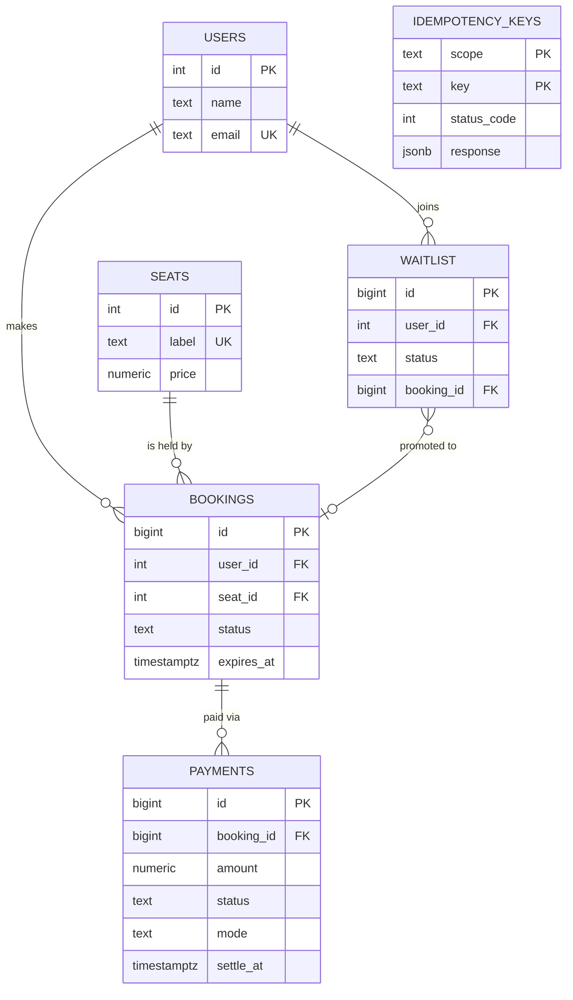
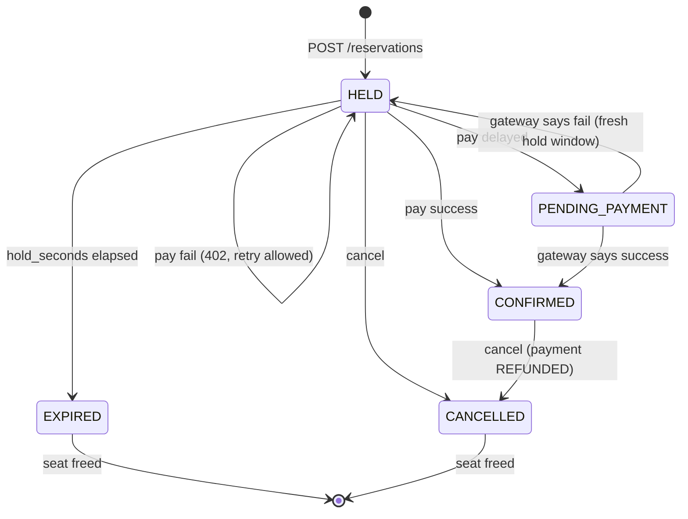
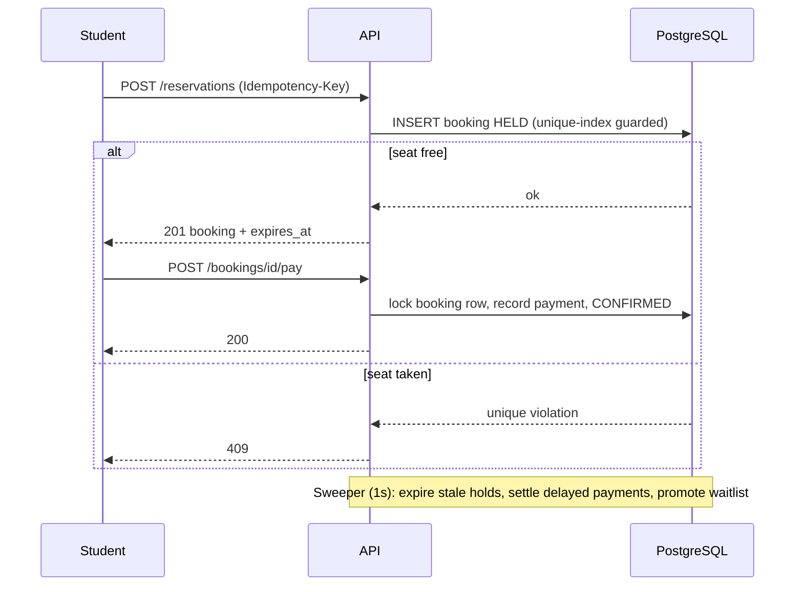

# Architecture

## ERD

## Booking state machine

Whenever a seat is freed (EXPIRED / CANCELLED) it is handed to the oldest waitlisted user in the same transaction; otherwise it returns to the pool.

## Workflow

## Concurrency handling
1. **The database is the referee.** `CREATE UNIQUE INDEX ... ON bookings(seat_id) WHERE status IN ('HELD','PENDING_PAYMENT','CONFIRMED')` means PostgreSQL itself rejects a second live booking for a seat, whatever the application does. If 1,000 requests hit seat 7 simultaneously, exactly one INSERT wins; the rest get a unique violation -> HTTP 409. No application-level locks or races to get wrong.
2. **Expiry cannot be gamed by timing.** Every read computes status from `expires_at > now()`, and `reserve` expires that seat's stale hold in the same transaction before inserting. The background sweeper is only a cleanup/promotion mechanism; correctness never depends on it running on time.
3. **Per-booking serialisation.** `pay` and `cancel` take `SELECT ... FOR UPDATE` on the booking row, so pay-vs-cancel-vs-expire on one booking are strictly ordered.
4. **Delayed payments protect the seat.** A delayed payment moves the booking to `PENDING_PAYMENT`, which never expires, so a seat can't be resold while money is in flight. A sweeper settles it when `settle_at` passes (state lives in the DB, so it survives restarts and works with many replicas).
5. **Idempotency.** `Idempotency-Key` rows are inserted in the same transaction as the work (`ON CONFLICT DO NOTHING`). A concurrent duplicate blocks on that insert until the first commits, then replays the stored response (`Idempotent-Replay: true`). If the first attempt rolls back, so does the key. Paying an already-confirmed booking is a no-op 200 even without a key.
6. **No deadlocks / no convoy.** Sweeper queries use `FOR UPDATE SKIP LOCKED` with a stable `ORDER BY`, so multiple sweepers/replicas never block each other.
7. **Waitlist fairness.** Freed seats are assigned to the oldest waiter inside the transaction that freed them, so a late arrival can't sneak in between.

## Scaling
- **App tier is stateless**: `docker compose up --scale app=N`; nginx balances. All coordination is in PostgreSQL.
- **Hot spot is the DB, by design**: a seat row conflict is a single index probe. Next steps in order: PgBouncer (transaction pooling) in front of Postgres -> read replicas for `GET /seats` and history -> **Redis** cache of the seat map (short TTL, invalidated on state changes) so the 10,000-user refresh storm never reaches Postgres.
- **Flash-sale front door**: put a Redis/virtual-queue (or the existing waitlist) ahead of `/reservations` and admit users at a controlled rate; rate-limit per IP in nginx (config included, commented).
- **Async side effects**: emit `booking.confirmed` events to Kafka/RabbitMQ/NATS (email, QR ticket, analytics) using an outbox table written in the same transaction.
- **Multiple events**: add `event_id` to `seats`/`bookings`; the partial unique index becomes `(event_id, seat_id)`, and tables can be partitioned by event.
